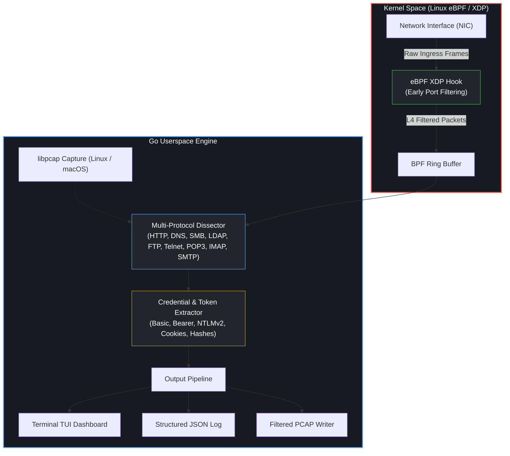

<div align="center">

# 📡 `driftnet2`
### Kernel-Level Network Sniffer, Credential Interceptor & Exposure Auditor

[](https://github.com/jankesec/driftnet2/stargazers)
[](https://github.com/jankesec/driftnet2/network/members)
[](https://github.com/jankesec/homebrew-tap)
[](https://go.dev)
[](https://ebpf.io)
[]()
[]()
[]()
[](LICENSE)

<p align="center">
  <b>High-performance, kernel-level packet inspection, credential extraction, and defensive security auditing.</b><br>
  <sub>eBPF/XDP In-Kernel Filtering · libpcap Capture Fallback · 9 Protocols · Hashcat-Ready NTLMv2 · DNS Tunnel Heuristics · Blue-Team Remediation</sub>
</p>

<p align="center">
  <a href="#-live-terminal-demo"><b>[ Live Demo ]</b></a> &nbsp;•&nbsp;
  <a href="#-architecture-why-kernel-level-ebpfxdp-matters"><b>[ Architecture ]</b></a> &nbsp;•&nbsp;
  <a href="#-the-9-protocol-engines"><b>[ 9 Protocols ]</b></a> &nbsp;•&nbsp;
  <a href="#-mitre-attck-matrix"><b>[ MITRE ATT&CK ]</b></a> &nbsp;•&nbsp;
  <a href="#-quick-start"><b>[ Quick Start ]</b></a> &nbsp;•&nbsp;
  <a href="#-blue-team-exposure-audit"><b>[ Exposure Audit ]</b></a> &nbsp;•&nbsp;
  <a href="#-red-team-scenarios"><b>[ Red Team Ops ]</b></a> &nbsp;•&nbsp;
  <a href="#-comparison"><b>[ Comparison ]</b></a>
</p>

<p align="center">
  
  <br><sub>Zero-Privilege Offline PCAP Replay & Credential Exposure Audit on Synthetic Test Captures</sub>
</p>

</div>

---

## ⚡ Architecture: Why Kernel-Level eBPF/XDP Matters

Driftnet2 supports two capture paths. On supported Linux hosts, an eBPF program
attached at XDP filters candidate TCP/UDP traffic before sending bounded packet
records through a BPF ring buffer. If the XDP object cannot be loaded—or on
macOS—the tool uses libpcap. Both paths feed the same protocol parsers and
output pipeline.

```
┌─────────────────────────────────────────────────────────────────────────────────────────────┐
│                                  DRIFTNET2 CAPTURE ARCHITECTURE                             │
│                                                                                             │
│                         ┌───────────────────────────────┐                                   │
│                         │    Physical / Virtual NIC     │                                   │
│                         └───────────────┬───────────────┘                                   │
│                                         │                                                   │
│   ┌─────────────────────────────────────▼───────────────────────────────────────────────┐     │
│   │                        LINUX KERNEL SPACE (eBPF / XDP)                             │     │
│   │                                                                                    │     │
│   │   ┌────────────────────────┐                                                       │     │
│   │   │  XDP Hook (Driver Layer)│ ──> Drops non-target traffic immediately             │     │
│   │   └───────────┬────────────┘                                                       │     │
│   │               │                                                                    │     │
│   │   ┌───────────▼────────────┐                                                       │     │
│   │   │ BPF Ring Buffer Stream │ ──> Bounded packet records for userspace              │     │
│   │   └───────────┬────────────┘                                                       │     │
│   └───────────────┼────────────────────────────────────────────────────────────────────┘     │
│                   │ Ring-buffer event stream                                                  │
│   ┌───────────────▼────────────────────────────────────────────────────────────────────┐     │
│   │                              USERSPACE ENGINE                                      │     │
│   │                                                                                    │     │
│   │   ┌────────────────────────────────────────────────────────────────────────────┐   │     │
│   │   │ Dual-Path Ingestion: eBPF Ring Buffer (Linux) OR libpcap Capture           │   │     │
│   │   └─────────────────────────────────────┬──────────────────────────────────────┘   │     │
│   │                                         │                                          │     │
│   │   ┌─────────────────────────────────────▼──────────────────────────────────────┐   │     │
│   │   │                     9 PROTOCOL PARSING ENGINES                             │   │     │
│   │   │     HTTP · SMB (NTLMv2) · LDAP · FTP · Telnet · POP3 · IMAP · SMTP · DNS   │   │     │
│   │   └──────────────────┬──────────────────────────────────┬──────────────────────┘   │     │
│   │                      │                                  │                          │     │
│   │   ┌──────────────────▼───────────────┐  ┌───────────────▼──────────────────────┐   │     │
│   │   │       RED TEAM CAPTURE           │  │          BLUE TEAM AUDIT             │   │     │
│   │   │  Raw Passwords, Tokens, NTLMv2   │  │  Cleartext Exposure Risk Assessment  │   │     │
│   │   │  Hashcat-Ready Hashes · JSON/PCAP│  │  Severity Grading · Remediation Guide│   │     │
│   │   └──────────────────────────────────┘  └──────────────────────────────────────┘   │     │
│   └────────────────────────────────────────────────────────────────────────────────────┘     │
└─────────────────────────────────────────────────────────────────────────────────────────────┘
```

- **Early Linux filtering:** The XDP program selects supported TCP/UDP ports and
  submits bounded packet data through a BPF ring buffer.
- **Portable fallback:** If XDP is unavailable, Driftnet2 uses libpcap while
  retaining the same parser and output behavior.
- **Compact Go executable:** No language runtime is required. Source builds use
  cgo/gopacket and therefore require libpcap at build time and on the target
  system unless the release artifact supplies it independently.

---

## 🎬 Live Terminal Demo

Run the end-to-end credential extraction and defensive audit offline against synthetic captures without root privileges:

```bash
# Clone and build
git clone https://github.com/jankesec/driftnet2.git && cd driftnet2
go build -ldflags="-s -w" -o driftnet2 ./cmd/driftnet2

# Analyze reproducible test PCAP with automated credential dump and exposure audit:
./driftnet2 -pcap examples/demo.pcap -output creds.json -audit
```

```text
    ____       _  ______            __   ___  
   / __ \_____(_)/ __/ /_____  ___ / /_ |__ \ 
  / / / / ___/ // /_/ __/ __ \/ _ \ __/ __/ / 
 / /_/ / /  / // __/ /_/ / / /  __/ /_ / __/  
/_____/_/  /_//_/    \__/_/ /_/\___/\__|____/ 

      kernel-level packet sniffer & credential extractor

[*] offline mode: examples/demo.pcap
[FTP] Login 192.0.2.10 → 198.51.100.20:21 — demo:Password123
[HTTP] Basic Auth 192.0.2.11 → 198.51.100.21:80 — demo:Password123
[POP3] Login 192.0.2.12 → 198.51.100.22:110 — demo@example.test:Password123
[IMAP] Login 192.0.2.13 → 198.51.100.23:143 — demo@example.test:Password123
[SMTP] AUTH PLAIN 192.0.2.14 → 198.51.100.24:587 — postmaster:smtppass
[TELNET] Session 192.0.2.15 → 198.51.100.25:23 — corp-router login: demo
[LDAP] Simple Bind 192.0.2.16 → 198.51.100.26:389 — cn=admin,dc=corp:ldappass
[SMB] NTLMv2 192.0.2.17 → 198.51.100.27:445 — jsmith::CORP:::4e544c4d53535000030000000
[DNS] Tunnel Detection 192.0.2.18 → 8.8.8.8:53 — DNS: TXlDMkV4ZmlsUGF5bG9hZERhdGFHb2VzSGVyZQ.c2.example.test

[*] 9 packets processed, 9 unique credentials found in examples/demo.pcap
[*] saved → creds.json

Credential Exposure Audit
=========================
9 findings — 7 High, 1 Medium, 1 Low

[HIGH] FTP — Cleartext password (1)
  Endpoints: 192.0.2.10 -> 198.51.100.20
  Fix: Disable plaintext FTP; use FTPS or SFTP.
...
```



---

## 📡 The 9 Protocol Engines

Driftnet2 extracts actionable credentials and session secrets across 9 protocols without requiring external dissectors:

| # | Protocol | Default Ports | Credential Type & Technique | Hashcat Mode | Example Output |
|:---:|:---|:---:|:---|:---:|:---|
| **1** | **HTTP** | `80, 8080, 443` | Basic Auth, Form POST fields, Bearer tokens, Session Cookies, Digest, NTLM | — | `admin:P@ssw0rd2026!` |
| **2** | **SMB / CIFS** | `445, 139` | NTLMv2 Challenge/Response handshake (User, Domain, Challenge, Response) | `5600` (NetNTLMv2) | `CORP\jsmith::...` |
| **3** | **LDAP** | `389` | Simple Bind cleartext credentials & DN paths | — | `cn=admin,dc=corp:SecretBind` |
| **4** | **FTP** | `21` | `USER` / `PASS` plaintext authentication commands | — | `ftpuser:Storage2026!` |
| **5** | **Telnet** | `23` | Interactive login prompt interrogation & user keystroke capture | — | `root:cisco123` |
| **6** | **POP3** | `110` | `USER` / `PASS`, `AUTH PLAIN` mailbox retrieval | — | `user@corp.com:MailPass!` |
| **7** | **IMAP** | `143` | `LOGIN` (quoted, literal, inline parameters) | — | `exec@corp.com:SecureMail1` |
| **8** | **SMTP** | `25, 587` | `AUTH LOGIN`, `AUTH PLAIN` MTA message transmission | — | `postmaster:SmtpSecret!` |
| **9** | **DNS** | `53` | Tunnel detection (entropy scoring, high-label length, Base64/Hex signatures) | — | `TXlDMk...c2.attacker.com` |

---

## 🎯 MITRE ATT&CK Matrix

Driftnet2 implements techniques from the MITRE ATT&CK Enterprise Matrix for adversary emulation and gap auditing:

| Tactic | Technique | ID | Driftnet2 Capability |
|:---|:---|:---:|:---|
| **Credential Access** | Network Sniffing | [T1040](https://attack.mitre.org/techniques/T1040/) | Live kernel-level eBPF & promiscuous packet sniffing |
| **Credential Access** | Adversary-in-the-Middle | [T1557.001](https://attack.mitre.org/techniques/T1557/001/) | NTLMv2 capture via SMB/LDAP authentication exchanges |
| **Credential Access** | Steal or Forge Kerberos / NTLM Hashes | [T1558](https://attack.mitre.org/techniques/T1558/) | Hashcat-ready NetNTLMv2 hash generation (`hashcat -m 5600`) |
| **Discovery** | Network Service Scanning | [T1046](https://attack.mitre.org/techniques/T1046/) | Unencrypted protocol service identification and endpoint mapping |
| **Command and Control** | Protocol Tunneling / DNS | [T1572](https://attack.mitre.org/techniques/T1572/) / [T1071.004](https://attack.mitre.org/techniques/T1071/004/) | Shannon entropy analysis for covert DNS tunnel detection |

---

## 🛡️ Blue Team: Exposure Audit (`-audit`)

Driftnet2 provides dual-mode output: while offensive operations focus on harvested credentials, defensive security teams can generate **actionable vulnerability assessments** directly from network captures:

```bash
# Generate full audit report and export machine-readable JSON:
./driftnet2 -pcap internal_traffic.pcap -audit -audit-output audit_report.json
```

### Risk Classification Model:
- **`[HIGH]` Exposure:** Cleartext passwords (FTP, HTTP Basic, POP3, IMAP, SMTP, LDAP Simple Bind) and crackable password hashes (SMB NTLMv2). Represents immediate credential compromise risk.
- **`[MEDIUM]` Exposure:** API Bearer tokens, active session cookies, and anomalous DNS tunneling indicators.
- **`[LOW]` Exposure:** Legacy unencrypted interactive sessions (Telnet banners, cleartext metadata).

### Sample Audit Remediation Output:
```text
Credential Exposure Audit
=========================
9 findings — 7 High, 1 Medium, 1 Low

[HIGH] SMB — Password hash (1)
  Endpoints: 192.0.2.17 -> 198.51.100.27
  Fix: Require SMB signing/encryption, restrict NTLM (prefer Kerberos), and enable Extended Protection for Authentication.

[HIGH] HTTP — Cleartext password (1)
  Endpoints: 192.0.2.11 -> 198.51.100.21
  Fix: Enforce HTTPS/HSTS; never send Basic auth, form credentials, or tokens over cleartext HTTP.

[HIGH] LDAP — Cleartext password (1)
  Endpoints: 192.0.2.16 -> 198.51.100.26
  Fix: Enforce LDAPS (TCP/636) or StartTLS; reject simple bind authentication over cleartext.

[MEDIUM] DNS — DNS tunnel indicator (1)
  Endpoints: 192.0.2.18 -> 8.8.8.8
  Fix: Investigate for tunneling/exfiltration; apply DNS filtering policy and query rate limiting.
```

---

## 🚀 Quick Start & Installation

### 1. Install via Homebrew (macOS / Linux)

```bash
brew install jankesec/tap/driftnet2
```

### 2. Build from Source

Requirements: Go 1.25+ and libpcap development headers (`libpcap-dev` on
Debian/Ubuntu, `libpcap-devel` on Fedora; provided by the system on macOS).

```bash
# Clone repository
git clone https://github.com/jankesec/driftnet2.git && cd driftnet2

# Build optimized binary
make build

# Confirm embedded version, commit, and build time
./driftnet2 -version
```

### 3. Linux Kernel eBPF/XDP Compilation (Optional)

On Linux hosts with Clang/LLVM installed, compile the kernel hook:

```bash
make bpf    # Compiles bpf/xdp_sniff.c into xdp_sniff.o
```

> [!NOTE]
> Driftnet2 auto-locates `xdp_sniff.o` in the working directory, binary directory, or via `-bpf /path/to/xdp_sniff.o` / `DRIFTNET2_BPF` environment variable. If absent, it uses the libpcap capture path.

### 4. Operational Invocations

```bash
# Live sniffing on specific interface with protocol filtering and PCAP logging:
sudo ./driftnet2 -iface eth0 --proto http,smb,ldap -output creds.json -w live_capture.pcap

# Offline PCAP triage without root privileges:
./driftnet2 -pcap /path/to/dump.pcap --proto http,ftp,telnet

# Full compliance audit with JSON export:
./driftnet2 -pcap /path/to/dump.pcap -audit -audit-output audit_report.json
```

---

## ⚔️ Red Team Scenarios

### 1. Active Directory Domain Controller Sniffing
Positioned on a mirrored span port or compromised switch interface, capture domain authentication exchanges:

```bash
sudo ./driftnet2 -iface eth0 --proto smb,ldap -output domain_hashes.json
```

Extracted SMB hashes are directly formatted for Hashcat:
```bash
hashcat -m 5600 -a 0 ntlm_hashes.txt /usr/share/wordlists/rockyou.txt -r rules/best64.rule
```

### 2. Lateral Movement Eavesdropping on Segmented Pivots
Deploy Driftnet2 to an authorized assessment host with a compatible libpcap
runtime to inspect administrative protocols:

```bash
# Transfer the release binary over SSH:
scp driftnet2 operator@jumpbox:/tmp/

# Run headless with JSON streaming:
ssh operator@jumpbox "sudo /tmp/driftnet2 -iface eth1 --proto http,ftp,telnet -output /tmp/harvest.json"
```

### 3. Covert DNS C2 & Tunnel Hunting
Identify covert data exfiltration channels and C2 beacons operating over DNS TXT or subquery records:

```bash
sudo ./driftnet2 -iface eth0 --proto dns -v
```

---

## 🔬 Capture Mode Matrix

| Mode | Platform | Privilege | Requirements | Intended use |
|:---|:---|:---:|:---|:---|
| **XDP/eBPF live capture** | Linux | Root or equivalent capabilities | Compiled `xdp_sniff.o`, compatible kernel/driver | Early filtering on supported interfaces |
| **libpcap live capture** | Linux / macOS | Usually root or capture privileges | libpcap and an accessible interface | Portable live inspection and XDP fallback |
| **Offline PCAP replay** | Linux / macOS | None for readable files | libpcap | Reproducible triage, demos, and evidence review |

All modes use the same nine protocol parsers, deduplication, JSON export, and
optional exposure audit. Encrypted application payloads remain opaque unless
traffic is decrypted before it reaches Driftnet2.

---

## 🛡️ Engineering Quality & Supply Chain

Every pull request and release is validated across Linux and macOS environments:

| Control | Gate & Verification |
|:---|:---|
| **Memory Safety & Race Testing** | `go test -race ./...` executed across all protocol parsers and buffer writers |
| **Static Code Analysis** | `golangci-lint` clean with 0 issues |
| **Security Auditing** | `gosec` static analysis gate |
| **eBPF Compilation** | Verified compilation in CI with `clang` and `llvm` |
| **Reproducibility** | Built-in test capture generator (`examples/gen`) ensuring deterministic parser tests |

---

## 📁 Project Structure

```
driftnet2/
├── bpf/
│   └── xdp_sniff.c            # In-kernel eBPF XDP filter & ring buffer engine
├── cmd/
│   └── driftnet2/
│       ├── main.go            # Unified CLI interface & session router
│       └── main_test.go       # Flag & configuration validation tests
├── pkg/
│   ├── audit/                 # Blue-team exposure auditor & remediation generator
│   ├── ebpf/                  # Cilium/ebpf loader & kernel ring buffer binding
│   ├── output/                # Live TUI and private atomic JSON/audit exports
│   ├── protocol/              # 9 Protocol parsing engines (HTTP, SMB, DNS, etc.)
│   └── sniffer/               # Capture engine (XDP + libpcap) and PCAP writer
├── docs/                      # Technical architecture, eBPF specs & parser guides
├── examples/                  # Deterministic demo PCAP generator & sample capture
├── Makefile                   # Unified compilation, testing, and linting workflow
└── SECURITY.md                # Vulnerability disclosure & authorized-use policy
```

---

## 🔐 Cryptographic Identity & Author

Driftnet2 is researched and developed for authorized penetration testing, adversary emulation, and network security gap analysis.

```text
Author          : Sevban Dönmez (@jankesec)
Role            : Senior Cyber Security Consultant · Red Team & Offensive Security Researcher
Research Portal : https://jankesec.com
GitHub          : https://github.com/jankesec
PGP Fingerprint : FF0A 7D83 6751 CCE3 F9CC F574 FCF8 39FB 7F00 4626
GPG Key ID      : 5FDB257F4AAE8C3F
```

---

## ⭐ Star History

[](https://star-history.com/#jankesec/driftnet2&Date)

If you find **driftnet2** useful for offensive security assessments or network analysis, please consider giving it a ⭐ star!

---

## ⚠️ Disclaimer

This tool is designed and distributed **exclusively for authorized network security assessments, penetration testing, defensive auditing, and academic research**. Intercepting network traffic or harvesting credentials without explicit, written authorization from network owners is illegal under computer crime statutes. The author assumes no liability for misuse, unauthorized monitoring, or regulatory violations.

## 📜 License

Distributed under the **MIT License**. See [`LICENSE`](LICENSE) for complete terms.

<p align="center">
  <a href="https://www.buymeacoffee.com/sevbandonmez">
    
  </a>
</p>
